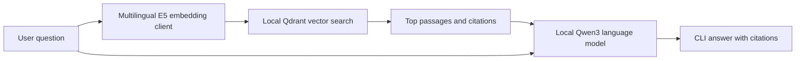

# RAG Research Assistant: Project Description

## Main idea

This project is a local research assistant for questions about methods, benchmarks, and limitations in detecting AI-generated text. It retrieves evidence from a curated collection of scientific papers and asks a local language model to explain that evidence with citations.

The tool helps a learner navigate research literature. It does not decide whether a user-provided text was written by a person or generated by AI.

## Concepts

- **RAG (retrieval-augmented generation):** retrieve relevant source passages first, then give those passages to a language model as context for an answer.
- **Chunk:** a bounded text passage with source metadata and PDF page numbers.
- **Embedding:** a numeric vector created from a passage or question so that semantically similar items can be found.
- **Vector database:** Qdrant stores each passage with its embedding and citation metadata, then searches for nearby vectors.
- **Citation grounding:** answers must refer to the titles and PDF pages attached to retrieved passages. The original publication links are displayed for verification.

## Design

The ingestion process extracts text from the source PDFs, divides it into page-attributed passages, converts each passage into a vector, and writes the vector, text, and metadata to Qdrant. For a question, the CLI converts the question into an embedding, retrieves the closest passages, and sends the original question plus those passages to Qwen. The model responds in the user's language and cites the sources.

## Dataset concept and source data

The initial corpus contains 10 publications selected to cover foundational work, detection methods, multilingual and real-world benchmarks, robustness evaluation, limitations, and a recent survey. The PDFs are in `data/raw/`; `SOURCES.md` records each title, year, type, and canonical publication URL. The extracted corpus is in `data/processed/chunks.jsonl`, with source, year, type, section, and PDF-page metadata on every chunk.

The corpus is representative for a small learning prototype, not exhaustive. It is a knowledge base for research questions, not a labeled dataset for training a text detector.

## System technical details

- **Language and runtime:** Python 3.9 or newer.
- **Embedding model:** [`intfloat/multilingual-e5-small`](https://huggingface.co/intfloat/multilingual-e5-small), run locally through Sentence Transformers. The model maps English source passages and Russian or English questions into a shared vector space. Its output dimension is 384.
- **Vector database:** Qdrant `v1.16.1`, run locally with Docker Compose. The collection is named `ai_text_detection_research`; it stores cosine-searchable vectors and passage payloads. The database files persist under `data/qdrant_storage/`.
- **Generation model:** Qwen3 4B Instruct through Ollama's local HTTP API at `http://127.0.0.1:11434`. The model weights are downloaded once and kept in Ollama's local model cache.
- **User interface:** CLI. The user enters a question; the program retrieves passages from Qdrant, sends the original question and retrieved passages to Ollama, and prints the answer and source list.
- **Dependencies:** listed in `requirements.txt`; Ollama and Docker Desktop are installed separately.

## Requirements to run

1. Python and the project dependencies installed in a local `.venv`.
2. Docker Desktop running, then `docker compose up -d` to start Qdrant.
3. Ollama installed and running locally.
4. The Qwen3 4B Instruct model downloaded with `ollama pull qwen3:4b-instruct`.
5. The corpus loaded into Qdrant using `scripts/ingest_database.py`.

The embedding and generation models run locally. No paid API key is required for the current design. The initial downloads require an internet connection and several gigabytes of disk space.

## Limitations

- The initial corpus contains only 10 publications; answers may miss relevant work outside it.
- PDF extraction can flatten tables, split words at line breaks, or misidentify section headings. Table-dependent claims should be checked against the original PDF.
- Passage boundaries are heuristic. Long passages are further split to fit the embedding model's input limit, which can separate related details.
- Vector similarity is a ranking signal, not a measure of truth. Retrieved passages and model-generated claims must be checked against the cited paper.
- A local 4B language model may produce awkward wording or unsupported claims despite the grounding instructions. The program lists the sources passed to the model to support verification.
- The tool is not designed to classify arbitrary user text as human-written or AI-generated.

## Demonstration video

Video link: [RAG Research Assistant demonstration](https://drive.google.com/file/d/1xeTCdiBOFgAzI880ZWsgpKCVS8DQuWH2/view?usp=sharing)
